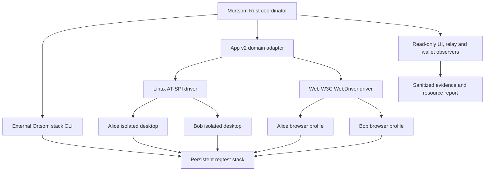

# Mortsom technical specification

**Version:** 0.2

**Updated:** 2026-09-08

**Status:** active implementation plan; live validation in progress

**Target:** Mostro app v2 (`MostroP2P/app`, local `../mobilev2`)

**Default platform:** Linux

This document specifies the complete migration from Android emulators and the legacy app to lighter Linux and
Web clients. It is normative for new work. The previous specification (Git revision `ec22af1:spec.md`) is
historical; its Android implementation remains available, with no new Android work in this migration.
Everything in this repository is written in English.

A requirement below describes the intended result, not a claim that it is implemented. Section 18 records the
current evidence separately. Section 17 tracks 65 tasks: 13 completed, 12 in progress and 40 pending.
Live scenario acceptance remains Linux 0/20 and Web 0/20.

## 1. Objective and completion criteria

Mortsom must launch two independent copies of app v2, Alice and Bob, against a persistent local stack managed
by Ortsom. The operator chooses Linux or Web; Linux is the default. Android remains an explicit selectable
option.

The migration is complete only when:

1. Stack creation, readiness, client launch, scenario execution and cleanup
   work through the documented CLI from a clean checkout.
2. At least the 20 priority scenarios in section 10 pass through the real app
   on Linux, with correlated UI, relay and wallet evidence.
3. Those same 20 scenarios pass on Web. A pass on both platforms counts as one
   distinct scenario, not two toward the required twenty.
4. Every accepted run finishes with successful order/payment cleanup and
   releases every client resource it owns. Failed unresolved runs follow the
   protected recovery-retention policy in section 11 and do not count as passes.
5. Comparable Linux/Web CPU and memory results are recorded using section 14.
6. Required automated checks pass, implementation changes receive independent
   review, and reproducible commands and evidence are documented.

Unit tests, a fake daemon, successful builds, onboarding, skipped cases and launch smoke tests do not count as
live scenario replications. A passing Ortsom invocation does not count as a passing Mortsom scenario.

## 2. Scope and ownership

| Component | Owner | Responsibility |
|---|---|---|
| Mortsom | This repository | Rust CLI, UI drivers, adapters, scenario narratives, safety, observers and reports |
| App v2 | `../mobilev2` | Flutter/Rust application, visible states, accessible controls and test bootstrap contract |
| Ortsom | `../ortsom` | Persistent regtest stack and reference scenario behavior |
| Mostro | `../mostro` | Daemon implementation and container image |
| Protocol | `../protocol` | Normative wire protocol |

Use sibling repositories to understand behavior; do not copy their source or import their scenario runner.
Mortsom owns an independent UI-driven runner. Protocol v1 gift-wrap transport is obsolete and must not be
accommodated. Reuse `mostro-core` protocol types and event constants. Keep its exact `=0.14.5` pin and
associated Nostr dependency line until a separate reviewed commit changes that pin.

The migration excludes new Android emulation work, legacy-app feature work, production deployment, arbitrary
protocol fuzzing and a mainnet benchmark. Existing mainnet protections remain mandatory even though acceptance
runs use real Lightning nodes on a local Bitcoin regtest network.

## 3. Architecture



The coordinator depends on external boundaries for command execution, client sessions, Docker inspection,
relay transport, wallets, host configuration and clock. Tests inject fakes through those boundaries. A
platform-neutral `UiSession` exposes navigation primitives; `AppAdapter` turns domain actions into user
journeys. Scenario bodies never contain browser or AT-SPI details.

Keep the existing Rust workspace. Add desktop drivers without duplicating budgeting, observers, state
normalization, adapter logic or reporting. Existing Android-named shared interfaces may be reused initially;
names must not make Linux/Web depend on an Android SDK, AVD, Appium or adb installation.

## 4. Operator workflow and CLI

The intended public workflow is:

```sh
# Create/update and validate the persistent environment.
mortsom --ortsom-dir ../ortsom stack up
mortsom --ortsom-dir ../ortsom stack status

# Validate prerequisites without creating an order or paying anything.
mortsom doctor --platform linux
mortsom doctor --platform web

# Linux and app v2 are the defaults for Alice and Bob.
mortsom run happy_sell
mortsom run happy_sell --platform linux
mortsom run happy_sell --platform web
mortsom run --tag ortsom-core-20 --platform linux
mortsom run --tag ortsom-core-20 --platform web

# Optional existing build; validate it before scenario actions.
mortsom run happy_sell --platform linux --app-artifact /path/to/bundle/mostro
mortsom run happy_sell --platform web --app-artifact /path/to/build/web

# Reserved/frozen path; requires an explicit Android-compatible config.
mortsom --config android.local.toml run happy_sell --platform android

# Inspect unresolved work before explicitly stopping the environment.
mortsom cleanup <run-id>
mortsom --ortsom-dir ../ortsom stack down
```

These commands are the target contract; section 18 identifies pending pieces. `mortsom stack up` invokes
`ortsom stack up` as an external command in the selected sibling checkout. Running that Ortsom command
directly is equally valid. `run` attaches to an already ready stack and fails with actionable instructions if
it is absent; it does not implicitly create or destroy it.

One selection applies to both actors. Mixed Linux/Web pairs are outside this iteration. Unknown platforms fail
before building or starting clients. Android selection must neither silently use Linux nor claim unsupported
new capabilities. Doctor reports only the dependencies needed for its selected platform. Missing required
tools are reported before expensive builds.

## 5. Persistent environment and latest mostrod

Ortsom owns Bitcoin regtest, its LND topology, the Nostr relay, Mostro and the associated persistent volumes
and connection metadata. Mortsom consumes explicit connection references, daemon public identity and declared
limits. It must not load a solver secret merely to obtain a daemon public key.

On `stack up`:

1. Resolve the configured Ortsom checkout and executable.
2. Pull `mostrop2p/mostro:latest`; a failed pull is a reported failure, not
   permission to silently use an old cached image.
3. Delegate stack creation/update to Ortsom with that image selected.
4. Check the running daemon's image against the resolved digest. An existing
   container must converge to the requested image; an unchanged tag string
   alone does not prove that it was updated.
5. Wait for relay, daemon and wallet readiness and validate regtest networks,
   identity, advertised relay endpoints, liquidity and declared daemon limits.
6. Record the immutable image digest, daemon version and stack configuration
   fingerprint, excluding secrets.

Refresh `latest` at explicit stack updates, never in the middle of a scenario or benchmark. A run uses the
already verified immutable image. Report the actual running image, not the local checkout version or a
hardcoded label.

Scenario teardown must never remove persistent containers or volumes. Stack reset is an explicit regtest
recovery operation: preserve evidence, unwind orders/payments, invoke supported Ortsom lifecycle commands,
then revalidate. Never infer ownership from a container-name prefix alone or delete an unrelated operator
environment. Failed readiness must not trigger a destructive reset.

## 6. Configuration, networks and safety

The committed example is `config/desktop.example.toml`. Runtime configuration and `*.local.toml` remain
ignored. Secrets use `env:` references, become `Secret` immediately, and never appear in command arguments,
build defines, logs or artifacts. Daemon public identity and local relay URLs are non-secret.

Configuration declares the lane, platform prerequisites, app profile/source or artifact, stack checkout,
wallet references, relay endpoints, order amount, per-order cap, cumulative run cap and bounded deadlines. No
cap means error. Host paths and platform settings must be validated without requiring a source checkout when a
valid prebuilt artifact is supplied.

Local acceptance uses actual regtest LND payments. It is not a simulated-wallet claim and does not demonstrate
mainnet interoperability. Network clearance is based on observed wallet/node networks; `localhost` and lane
`local` do not prove regtest. Existing explicit mainnet confirmation remains fail-closed.

Reserve budget before a payment can begin. Include all orders in range and multi-order scenarios and account
for fees and pending payments according to the existing safety policy. Resetting an app, retrying
infrastructure or moving to the next scenario must never reset the cumulative run budget.

Only one active run may use a given exclusive stack/wallet set. Separate artifact directories must not defeat
environment locking. A second run reports the conflict before launching clients or making changes.

## 7. Client builds and public automation contract

Build app v2's Mortsom entrypoint, `lib/main_mortsom.dart`, with an explicit test-environment marker, daemon
public identity and local relay seeds. Disable public production fallback before subscriptions begin. Validate
discovered relay addresses from the client's network namespace; a Docker-internal hostname is not
automatically reachable by desktop or browser clients.

Follow the app's supported generation/build scripts. Regenerate Flutter Rust Bridge bindings through
`scripts/frb-generate.sh` before source builds to avoid Dart/Rust content-hash mismatches. Do not hand-edit
generated bindings. For Web, build the supported Rust/WASM bundle before the Flutter Web artifact. Retain
required shared-memory support and serve cross-origin isolation headers.

Record source revision, dirty-state indicator, build flags, tool versions and artifact digest. Both actors use
the same artifact. A prebuilt artifact must pass visible environment/identity checks; path existence alone is
insufficient.

The app owns `docs/automation-contract.md`. Stable IDs cover onboarding, navigation, node/relay settings, form
fields, order identity/status, invoices, cancellation, disputes, ratings and errors. Add missing controls as
ordinary accessible product UI, with coordinated app/harness review and widget tests. No test-only
business-action endpoints are allowed.

### 7.1 Linux

Each actor owns a native app process, virtual X display, private session bus, AT-SPI accessibility bus, Secret
Service instance and separate XDG storage. XDG isolation alone is insufficient because shared Secret Service
can reuse another actor's identity. Allocate displays without a fixed-port race.

Readiness waits must prove accessibility registration and an unlocked usable credential collection before app
launch. Use bounded predicates and child liveness checks. Disable incidental desktop service activation that
can leave portal or filesystem mounts outside the owned process lifecycle.

Flutter's Linux engine may not export `Semantics.identifier`. In Mortsom test builds the app exposes
`[mortsom:<identifier>]<readout>` as its accessible name. Keep this namespacing out of normal production
labels. Use public AT-SPI interfaces for action, focus, text entry, scrolling and state observation. A
transport success must not substitute for visible input acceptance.

### 7.2 Web

Serve the release bundle on loopback with `Cross-Origin-Opener-Policy: same-origin` and
`Cross-Origin-Embedder-Policy: require-corp`. Limit requests to files inside the canonical bundle root,
including symlink/traversal checks. Own every request task and terminate it when the server shuts down.

Use W3C WebDriver and separate browser profiles for Alice and Bob. Keep the browser sandbox enabled. Match
exact `flt-semantics-identifier` values with properly escaped selectors; IDs can include relay URLs and
dynamic order IDs. Use public DOM/accessibility interactions only. No JS calls into Dart, Rust, application
stores or private state are permitted.

Flutter may retain offscreen semantic fields and rebuild them after focus or scroll. Re-find elements after
transitions; scroll through normal user actions and wait for interactability. Do not add fixed sleeps to mask
animation races. Retain isolation headers for WASM workers and record browser/driver versions.

## 8. Identity and scenario isolation

Every new scenario starts with fresh Alice/Bob app storage and distinct generated test identities. Observe
public identities through the normal UI, prove they differ, relaunch each app, and prove each identity
persists. Do not export mnemonics to reproduce a run. Evidence uses opaque actor labels where possible.

Within a persistence scenario, preserve that actor's profile across the intended restart. Between scenarios,
close sessions and reset profile, secure storage, navigation and order subscriptions. Wallets may remain part
of the persistent stack, but observations use scenario-specific invoice hashes and order IDs. Never use a
global balance delta as proof of a particular payment.

Start observers before relevant actions. Reject mismatched daemon identity, unready relay or failed actor
bootstrap before creating an order. A bootstrap check in a report must influence the run outcome rather than
being informational.

## 9. Scenario actions and assertions

Scenarios express business actions through the shared app adapter. Linux and Web run the same narrative. Reuse
`mostro-core` wire types and maintain an explicit mapping to visible app states. Loading, payout pending,
escrow settled, payout completed, cancellation and expiration must not collapse into a misleading success
state.

The supported manual external-wallet path is valid: read the invoice presented by the app, pay it on the
actor's dedicated LND wallet, and type the buyer's wallet-generated invoice into the normal form. Wallet
actions perform the external user's wallet role; they must not publish create/take/release/cancel protocol
messages. NWC remains a separate capability with its own UI setup.

Every wait has a predicate, deadline and failure category. Negative assertions observe an explicit interval
starting after the action, with a sequence cursor so earlier events cannot satisfy them. Expiration waits
derive from declared daemon limits plus bounded sweep/propagation allowance. No fixed scenario sleeps.

An accepted trade joins the visible order ID, daemon-signed public relay observations, hold invoice hash,
buyer payout hash, amounts and terminal wallet outcomes. A completed-looking screen alone is insufficient. Do
not obtain private app keys to decrypt messages just to reproduce Ortsom's assertions; use the UI plus
legitimately observable public events and wallet results.

## 10. Twenty priority Ortsom replications

The source catalogue is `../ortsom/docs/scenarios.md`; reference bodies live under
`../ortsom/crates/ortsom/src/scenarios/`. Preserve their business assertions while replacing protocol-native
actor actions with real UI journeys. Register stable source names and the `ortsom-core-20` tag; existing
aliases may remain but cannot count as additional scenarios.

| # | Source scenario | Required live assertions and prerequisites |
|---|---|---|
| 1 | `happy_sell` | Alice sells, Bob takes/provides invoice/reports fiat, Alice releases; both show completion and matching escrow/payout settle exactly once. |
| 2 | `happy_buy` | Bob creates a buy, Alice takes as seller; same correlated settlement with reversed maker/taker roles. |
| 3 | `cancel_before_taken` | Maker cancels pending order; book removal and legal terminal UI, with no payment. |
| 4 | `cooperative_cancel` | Funded active order requires both actors' agreement; cancellation is visible to both and seller escrow is refunded. |
| 5 | `unilateral_cancel_rejected` | First cancellation opens cooperation only; no premature cancellation/refund during the observation window; complete cooperative cleanup afterward. |
| 6 | `cancel_after_take_unpaid` | Taker abandons without completing payment prerequisites; a new post-take event returns the order to a legal pending/terminal state after the declared deadline. |
| 7 | `pending_order_expires` | Set expiry through the create-order UI; untouched order expires and leaves the book. Requires a visible expiry control and actual daemon-enforced deadline. |
| 8 | `hold_invoice_expires` | Buyer supplies a valid invoice, seller leaves hold unpaid; observe the daemon's new pending/canceled/expired transition and no settlement. |
| 9 | `buyer_invoice_deadline` | Buyer never submits payout invoice; observe the declared deadline and new legal recovery/terminal state, without matching the initial pending event. |
| 10 | `full_trade_with_rating` | Complete a trade; both rate through UI; rating acceptance and resulting reputation/history are observable without duplicate settlement. |
| 11 | `range_order` | Create a range, take an intermediate fiat amount, verify priced amount and remainder identity/amount, complete taken portion and clean remainder. |
| 12 | `market_price_order` | Select market pricing through UI, observe resolved sat amount, enforce caps against it and verify payout with declared fee tolerance. |
| 13 | `dispute_by_buyer` | Buyer reports fiat and disputes; both show dispute and a matching public dispute event exists; prove a supported cleanup path before funding. |
| 14 | `dispute_by_seller` | Seller disputes an active trade; both UI states and public dispute identity correlate; prove supported cleanup before funding. |
| 15 | `dispute_then_cooperative_cancel` | Open an untaken dispute, cooperatively cancel through both clients, observe closed dispute and refunded seller escrow. |
| 16 | `invalid_buyer_invoice` | Submit a malformed/expired/wrong-amount invoice through UI; rejection must retain a recoverable invoice-required state and cause no illegal payment. Distinguish local validation from daemon rejection. |
| 17 | `payout_invoice_below_the_expiry_floor` | Submit an LND invoice below the declared minimum expiry; rejection and no advancement. Requires configurable invoice expiry and known daemon floor. |
| 18 | `payment_fails_on_release` | Invalidate the accepted buyer invoice on the controlled wallet, release through UI, observe payout failure/retry or replacement request, then recover payment and account for escrow. |
| 19 | `buyer_invoice_expires_mid_flight` | Make the previously accepted invoice unpayable after activation, release, submit a fresh invoice through UI, and prove recovery without duplicate payout. |
| 20 | `payout_slots_capped_per_destination` | Release trades to controlled buyer hold invoices up to the declared destination cap; the next receives no HTLC until a slot frees, then dispatches automatically; settle and account for every trade. |

This prioritizes ordinary user journeys, deadlines, dispute visibility and payment recovery.
`pending_order_expires` replaces the earlier provisional fairness candidate because it covers a common
user-visible deadline at lower resource cost. Destination-cap behavior remains in the required set.

`gated_payouts_do_not_starve_other_destinations` is an additional follow-up: fill Bob's cap and all declared
dispatch pressure, then prove an ordinary payout to Alice proceeds. It requires extra simultaneous trades and
budget; it is not a substitute for one of the twenty unless the matrix is explicitly revised with a
source-backed reason and independent review.

Solver resolutions, anti-abuse bonds, malformed encryption, unauthorized protocol actors and packet replay
remain outside this initial matrix. Do not fabricate UI parity for actions a normal client cannot express.

### 10.1 Missing app capabilities

Missing expiry/range/rating controls or accurate states are implementation work, not waived assertions. Add or
repair them in app v2 with accessible identifiers, visible user feedback, contract documentation and tests.

Disputes require special preflight: Mortsom must prove a user-accessible exit and refund path for the tested
untaken dispute. It cannot use an imported solver key or protocol-native admin action as a hidden cleanup
shortcut. If a dispute is taken or the supported UI cannot unwind it, stop and report unresolved escrow; do
not mark the scenario accepted or launch more funded cases. Fix the product workflow or explicitly revise the
plan before claiming completion. Destroying regtest volumes is not evidence of a refund.

Payment fault injection is confined to invoices and HTLCs on run-owned regtest wallets. It never edits
app/daemon databases or changes orders. Each fault declares its prerequisite, injection point, expected
visible response, negative payment assertion and recovery/cleanup route.

## 11. Error handling, cleanup and recovery

Use typed failure categories: product, automation contract, infrastructure, relay, wallet and environment
misconfiguration. Do not infer a category from message text. A missing control is not evidence that an order
is closed. A successful input API call is not evidence that the app accepted the value.

Register cleanup as soon as submission can create an order, including uncertain submission outcomes. Discover
new run-owned order IDs through public UI and relay observations to avoid orphaning an order when confirmation
is missed. Never blindly repeat submit/release/pay after a timeout.

On success, failure or interruption:

1. Preserve sanitized UI/relay/wallet evidence before closing clients.
2. Resolve or cancel every tracked order through supported UI, including range
   remainders and all destination-cap trades.
3. Verify terminal wallet outcomes; record outstanding hashes and escrow.
4. Close both client sessions, request tasks and owned process groups even if
   one cleanup step fails; retain enough handles to retry failed cleanup.
5. Remove owned temporary profiles and credential storage only after all
   orders/payments are resolved. For unresolved orders retain protected actor
   storage as described below; still stop owned processes, buses and displays.
6. Report every cleanup failure. Unresolved cleanup prevents acceptance.

### 11.1 Durable UI recovery

Persist a sanitized recovery manifest as soon as an order may exist. It records run/stack identity, actor
labels, order IDs, invoice hashes, artifact provenance, cleanup steps and references to protected storage; it
contains no private keys. Store recoverable actor profiles and Linux credential-service data outside the
repository under the operator's private state directory, with owner-only permissions. Never export mnemonics
or private app keys to the manifest.

If UI cleanup fails with unresolved orders, stop processes but retain those profiles and their Secret Service
state. A subsequent `cleanup <run-id>` reacquires the environment lock, validates the same stack and app
provenance, starts new private runtime services using retained storage, verifies the original public actor
identities and retries only the required normal UI actions. Web reuses the protected browser profile and its
original loopback origin (scheme, host and port);
record and rebind that origin because Web storage is origin-scoped. If the original port cannot be rebound,
report an explicit recovery failure instead of silently using a new origin. Linux reuses both app and
credential data. A missing profile or identity mismatch is an explicit
unrecoverable-identity error, never permission to create a fresh identity and call cleanup successful.

Track retained storage and recovery status in `cleanup.json`. Retention lasts until confirmed order/payment
resolution and an explicit successful cleanup, not an automatic expiry that destroys the only recovery
identity. Cleanup must never remove unresolved storage through a generic temporary-directory sweep. A stack
reset may be needed for regtest diagnostics, but record unresolved outcomes before reset; disappearance after
reset is not proof of cancellation.

A subsequent clean run must not inherit identities or browser profiles. Refuse a funded run on the same
wallet/stack set while tracked orders or held payouts remain unresolved; recover them first.
Infrastructure retries are bounded and explicitly configured; they preserve the failed attempt and cumulative
budget. Product, contract or payment-correlation failures must not be retried into a hidden pass. For
development, fix the cause and start a new recorded run.

## 12. Reports and reproducibility

Keep existing summary, timeline, UI screenshots/hierarchy, relay events, wallet payments and cleanup artifacts
under ignored `artifacts/<run-id>/`. Extend reports with platform, app revision/artifact digest, dirty state,
Flutter/Rust/browser/driver versions, stack identity, actual daemon image version/digest, declared limits,
seed relay endpoints, lane and resource data.

Record scenario source name, actor roles, attempt number, timings, required capabilities, status, explicit
failure category and cleanup status. A skip or unsupported capability is visible and never counted toward
twenty. Persist a per-platform acceptance ledger with run IDs and sanitized evidence locations.

Sanitize process errors as well as successful output. Raw app/service logs may exist only in actor-private
directories with restrictive permissions and must be removed on teardown; do not publish them. Never capture
the operator's real desktop when taking a Linux screenshot. Keys, mnemonics, credentials, NWC URIs and
sensitive invoice content must not leak into evidence.

## 13. Automated validation and review

Follow TDD for implementation changes. Add meaningful tests for configuration, platform selection, command
plans, redaction, actor isolation, bounded waits, state mapping, budgeting and cleanup failures. Exercise
desktop coordinator paths through injected sessions, including partial startup and persistent-stack
non-destruction. Test profile cleanup when executables are missing and static server shutdown with an
in-progress request.

Before every commit:

```sh
cargo fmt --all
cargo clippy --workspace --all-targets -- -D warnings
cargo test --workspace
```

Maintain at least 80% line coverage with `cargo llvm-cov`; scenario narratives are tests rather than
production code under test. App contract changes require relevant Flutter tests/analyze and the app's
documented Rust checks. New or updated dependencies require a latest-stable check, respecting the explicit
Mostro/Nostr pin exception.

Use independent review subagents as requested: review each completed change before commit, then review the
resulting commit for overlooked bugs. Resolve findings and rerun affected checks/live scenarios. Use
Conventional Commits, separate completed specification tasks, and never commit secrets or artifacts.

## 14. CPU and memory comparison

Measure Linux and Web after correctness, using the same physical host, daemon image digest, app revision,
relay, wallet state, scenario order, amounts, headless policy and declared deadlines. Run sequentially so
modes do not compete. Exclude Flutter/Rust compilation from execution measurements and report cold
build/startup costs separately.

Collect at a documented sampling interval (initial target: one second):

- Cumulative process-tree CPU seconds and mean CPU cores used, with a stated
  percentage convention; distinguish lifecycle/startup, idle and scenario work.
- Combined RSS and peak sampled RSS for both clients plus required helpers:
  Xvfb, private buses/AT-SPI/keyring for Linux; browser subprocesses,
  ChromeDriver and Web server for Web. RSS can double-count shared pages;
  include PSS when available and disclose the limitation.
- Shared stack/container CPU and memory separately, preventing shared daemon
  costs from being attributed to one client platform.
- Startup time, scenario duration, total elapsed time, pass/failure counts and
  number of open processes after teardown.

Use at least three complete measured repetitions per platform, alternating platform order. Report median and
range, raw sanitized samples, measurement boundaries and host/tool versions. Idle comparison uses a declared
observation window after both clients are ready; it does not introduce sleeps in scenarios. Do not claim CPU
savings from RSS alone or present failed/incomplete suites as comparable performance results. Do not start
Android emulators for this study; use an existing comparable Android baseline only if one already exists and
label its limitations. Otherwise report Linux versus Web only.

## 15. Dependencies and implementation risks

| Risk | Planned resolution |
|---|---|
| Linux semantics IDs absent | Test-build name prefix plus app-owned contract and widget coverage |
| Linux text API reports success without editing | Focus/edit through public accessibility; verify value and form response before submit |
| Web semantics offscreen or rebuilt | User scrolling/focus, exact selectors, fresh lookup and bounded interactability waits |
| Shared credentials or leftover services | Private DBus/Secret Service and profiles; readiness and failure-cleanup tests |
| Dart/Rust binding mismatch | Official regeneration before build; record artifact provenance |
| Docker relay address unreachable from host | Verify advertised endpoint reachability and test relay restrictions |
| App conflates pending payout with completion | Repair user-visible state mapping and assert actual wallet settlement |
| Missing dispute exit | Prove UI cleanup before funding; repair app workflow and revalidate |
| Expiry or payout limits differ from assumptions | Read declared stack limits and verify behavior against running daemon |
| Cap test consumes too many resources | Use explicit small test limits supported by Ortsom, budget every trade, preserve assertions |
| Multiple-run interference | Lock the environment/wallet set, scope events, reset clients between scenarios |

## 16. Delivery artifacts

The delivered change includes the Rust implementation, coordinated app v2 contract fixes, CLI/config examples,
operator setup and recovery documentation, the scenario matrix/acceptance ledger, reviewed commits, required
automated check results and a standalone resource comparison with reproducible commands.

Document prerequisites instead of relying on tools manually installed during development. Include headless
Linux and Chromium/WebDriver setup, supported paths and failure messages. A user must be able to reproduce
acceptance after recreating the stack and building the app from documented source revisions.

## 17. Sequential implementation plan and exit gates

Execute phases in order and close the preceding gate before starting planned later-phase work. Existing
exploratory builds and live probes are recorded as completed narrow tasks where supported by evidence;
these diagnostic results do not imply that any intervening phase has passed its gate.

### 17.1 Task status convention

- `[x] DONE`: the narrowly described task is completed with the evidence
  stated. This does not imply the containing phase has passed its exit gate.
- `[ ] IN PROGRESS`: code or a partial result exists, but required validation
  or corrections remain. Do not count it as completed.
- `[ ] TODO`: implementation or acceptance work remains.

Gate status is separate from task status. Diagnostic live attempts are allowed to expose missing requirements;
they cannot waive an earlier incomplete gate. When updating a checkbox, add a commit, check result or live run
ID. Do not mark a task done solely because its function or file exists.

### 17.2 Phase 0 — Specification and baseline

**Status:** completed. **Primary files:** `spec.md`, `docs/ortsom-ui-parity.md`, `docs/stack.md`.

- [x] **P0.1 DONE — Inventory the existing design and sibling contracts.** Read Mortsom's previous spec,
  Ortsom's catalogue and source families, and app v2's build/accessibility contract. Ownership is specified in
  sections 2–3.
- [x] **P0.2 DONE — Establish the source catalogue and initial matrix.** Identify twenty distinct source
  narratives; section 10 records the selected scope and the reason for changing the provisional fairness
  candidate.
- [x] **P0.3 DONE — Establish the existing Rust baseline.** Earlier workspace library/integration tests
  passed. Fix the current clippy large-error warning with boxed device-startup errors in reviewed commit
  `b4af42d`.
- [x] **P0.4 DONE — Record the migration ownership amendment.** Reviewed commit `ec22af1` established
  persistent-stack and Linux/Web execution gates; this version expands and supersedes that short amendment.
- [x] **P0.5 DONE — Review and commit the complete specification.** Independent review checked source
  fidelity, phase counts, actual bootstrap evidence and zero trade passes. Corrected invoice ordering, event
  cursor timing, secret-free stack metadata and durable UI recovery including Web origin. The twenty-row
  ledger and local links were checked; fmt, clippy and workspace tests passed before this documentation
  commit.

**Gate G0: passed.** Specification review findings are resolved; phase tasks, the twenty-case matrix and
current evidence agree.

### 17.3 Phase 1 — Stack integration, configuration and CLI

**Status:** in progress. **Primary files:** coordinator `src/stack/`, `src/cli.rs`, `src/config/`,
`src/desktop.rs`, `src/doctor/`, `config/desktop.example.toml` and CLI integration tests.

- [x] **P1.1 DONE — Start the real reference environment.** The external Ortsom stack command successfully
  brought up the development regtest topology.
- [x] **P1.2 DONE — Update the development daemon image.** Pulled latest and recreated the running daemon on
  the digest recorded in section 18, retaining the stack identity. This is a one-time verified update, not
  proof that the new Mortsom update command already converges existing containers correctly.
- [ ] **IN PROGRESS — P1.3 Complete the stack command adapter.** Existing
  `stack::{invoke,binary,StackContext}` delegates lifecycle commands with a pinned Compose project. Twelve
  stack tests and a live `mortsom stack up` passed digest/ownership/readiness checks; independent review
  passed. Remaining gate checks include durable metadata and post-run persistence; failures never destroy the stack.
- [x] **P1.9 DONE — Consume a secret-free stack descriptor.** Reviewed Ortsom commits `8e82712`, `029e90e`,
  `1552992` and `566a53e` export versioned status, declared limits, inspected endpoints and atomic container
  image identity. Mortsom validates those fields without opening combined solver TOML. Required records,
  nonzero limits, image/digest consistency, local endpoints and credential paths have regression coverage;
  149 coordinator tests, CLI tests and full clippy passed, with independent review. Live read-only status
  confirmed the pinned image. Persistence of these facts belongs to P1.8.
- [x] **P1.4 DONE — Complete platform/configuration selection.** Linux is the default; Web/Android and
  explicit configuration selection have CLI regressions. Desktop uses shared `[ui]` deadlines without AVD
  placeholders; Android-only commands require `[android]`. Cleanup follows the platform recorded before
  client startup, rejects conflicting metadata and explicitly reports unsupported desktop recovery. Artifact
  commands load only offline settings; publication preserves platform-specific known-secret resolution.
  Independent review passed after compatibility fixes; 167 coordinator tests, seven CLI integration tests,
  formatting and full workspace strict clippy passed on 2026-09-08. Desktop recovery remains P2 work.
- [ ] **IN PROGRESS — P1.5 Finish artifact preparation.** Source lookup is confined to builds; supported binding
  and Web scripts, tool resolution and sanitized failures are wired. Tests pass for source-absent prebuilt
  clients, invalid/incomplete bundles and generation failures/missing outputs. Provenance validation remains.
- [ ] **IN PROGRESS — P1.6 Implement platform-aware doctor.** Linux/Web doctor resolves public stack status
  and checks selected runtime/build tools, app-owned codegen pins, Linux development libraries and Web
  nightly/rust-src prerequisites. Real source-build diagnostics passed Linux 38/38 and Web 35/35 checks;
  prebuilt paths passed Linux 21/21 and Web 17/17. Daemon identity/protocol, local endpoints, regtest wallet
  capabilities and liquidity are checked read-only. Enforce these prerequisites before an expensive run
  build and finish the no-order/no-wallet-mutation boundary audit before completion.
- [ ] **IN PROGRESS — P1.7 Lock stack/wallet ownership independently of artifacts.** Reviewed canonical-HOME
  lock serializes stack/client lifecycle mutations, including updates and cleanup, independently of artifacts.
  Unit/CLI tests cover contention and release. Direct Ortsom commands and other users are outside this
  guard; durable unresolved-work exclusion remains a separate phase 2 acceptance requirement.
- [ ] **IN PROGRESS — P1.8 Persist immutable environment metadata.** Summary/environment now carry platform,
  public stack facts and a complete bundle hash. Targeted checks cover hash stability/content sensitivity
  and keeping registered secrets redacted while retaining public image hashes. Complete daemon version,
  source/build provenance and stack configuration fingerprint. Run-owned private bundle copies now use
  descriptor-relative capture, reject source changes/special files, and revalidate content and executable
  requirements before launch. Web shutdown drains owned requests before releasing the captured bundle;
  regressions and real single-client smoke checks passed on both platforms.

**Gate G1:** CLI/config/doctor and update/readiness tests pass; real `stack up` converges to the requested
digest; a failed or successful run demonstrably leaves persistent stack resources intact. **Gate not yet
accepted.**

### 17.4 Phase 2 — Builds and isolated Linux/Web clients

**Status:** in progress. **Primary files:** `crates/desktop-driver/src/`, coordinator `src/run/farm.rs`,
`src/bootstrap.rs`, `src/run/mod.rs`, app v2 `lib/core/automation/`, Mortsom entrypoint and automation
contract tests.

- [x] **P2.1 DONE — Prove app v2 builds locally on both targets.** Native release and Web release/WASM builds
  succeeded after official binding regeneration.
- [x] **P2.2 DONE — Prove Linux accessibility discovery.** Isolated native smoke observed the environment
  marker and walkthrough controls through AT-SPI.
- [x] **P2.3 DONE — Prove Web accessibility discovery.** Isolated Chromium smoke observed the same environment
  marker through the public semantics DOM.
- [x] **P2.4 DONE — Prove actual onboarding and restart identities.** Linux run
  `20260908T100217Z-a9eaf0273a29` and Web run `20260908T100434Z-7f107aaadcd8` passed both actors'
  bootstrap/identity checks. Their trade assertions failed and are explicitly not part of this completion.
- [ ] **IN PROGRESS — P2.5 Finish native interaction correctness.** Existing `native.rs` and `linux.rs` expose
  AT-SPI actions/text/state. Add focus and scroll handling, verify actual editable values and visible form
  feedback, and handle transient stale nodes without hiding permanent transport errors. Reproduce the
  empty-field failure before fixing it.
- [ ] **IN PROGRESS — P2.6 Finish Web interaction correctness.** Existing `web.rs` supports exact escaped IDs
  and input/readout lookup. Add bounded user scrolling and re-find after focus/rebuild. Reproduce the clipped
  sats field; test non-interactable and stale nodes without fixed delay or duplicate submit. Do not toggle
  fixed/market mode merely because a field is offscreen.
- [ ] **IN PROGRESS — P2.7 Close Linux lifecycle review findings.** Private XDG/DBus/AT-SPI/keyring and
  automatic display allocation exist. Validate the new unlocked-keyring readiness predicate, child health,
  aggregate cleanup, retained retry handles and absence of leaked mounts/processes after failure.
- [ ] **IN PROGRESS — P2.8 Close Web lifecycle review findings.** Guard profile directory creation before
  every fallible startup step; test missing driver, failed session/navigation and teardown errors. Own
  static-server request tasks with a join set or equivalent and abort/drain them on shutdown.
- [ ] **TODO — P2.9 Inject desktop session construction.** Add a factory seam to `RunDeps` returning
  independent `Arc<dyn UiSession>` handles and owned server resources. Remove hardcoded real runners from
  `Farm::desktop`; test second-actor failure, sibling survival and teardown through fakes.
- [ ] **TODO — P2.10 Implement per-scenario actor reset.** Close old sessions, create new storage/credentials,
  rerun bootstrap and rebuild actor context while retaining the run budget and persistent stack. Test that
  previous IDs, subscriptions and profiles cannot be reused accidentally.
- [ ] **IN PROGRESS — P2.11 Finish app contract coordination.** Linux name prefixes and desktop sidebar
  navigation fixes exist. Review and test all direct `Semantics` nodes, production-label isolation, visible
  readouts and test-relay restrictions. Run the app's prescribed checks before committing.
- [ ] **TODO — P2.12 Implement protected recovery storage.** Add durable manifest and actor-storage ownership
  records before a UI submission can create an order. Separate process shutdown from profile deletion; test a
  coordinator restart followed by UI-only cleanup with the original identities, missing storage, mismatched
  stack and successful final deletion.

**Gate G2:** both platforms pass fresh two-actor bootstrap and restart plus input/navigation smoke, injected
partial-failure tests and verified complete client cleanup. **Gate not yet accepted.**

### 17.5 Phase 3 — One fully correlated happy sell

**Status:** diagnostic implementation in progress; zero live passes. **Primary files:**
`scenarios/src/smoke/happy_sell.rs`, `scenarios/src/flow.rs`, v2 adapter `src/screens/{nav,orders}.rs`,
`src/states.rs`, scenario-kit `actions.rs`, `evidence.rs`, `waits.rs`, `cleanup.rs` and wallet/relay
observers.

- [ ] **IN PROGRESS — P3.1 Repair and verify creation.** Read back fiat, payment method, pricing mode and sats
  through public interfaces before submit; assert enabled state. Wait for a new order ID and public pending
  event. Preserve the failed Linux/Web form cases as meaningful regressions.
- [ ] **TODO — P3.2 Handle uncertain submission safely.** Capture known order IDs and observer cursor before
  submit; register provisional cleanup, resolve any new run-owned order after timeout, and never blindly
  republish.
- [ ] **TODO — P3.3 Validate discover/take and invoice steps live.** Match the exact order ID in Bob's book
  and take it. For a sell order, Bob first generates and submits the buyer payout invoice through normal UI;
  only then does Alice read and pay the seller hold invoice. Reserve spend before initiating payment and track
  both hashes.
- [ ] **TODO — P3.4 Validate state and final settlement.** Drive fiat-sent and release UI, distinguish
  intermediate payout states from completion, verify both clients' terminal state plus matching wallet
  amounts/outcomes and absence of duplicate settlement. Correct inaccurate product state mapping explicitly.
- [ ] **IN PROGRESS — P3.5 Make cancellation/teardown truthful.** Fixed missing cancel control returning
  AlreadyClosed for active, loading or unknown states; the regression failed before the fix and all 30 v2
  adapter tests passed afterward, with independent review. Cancelled currently acknowledges the confirmation
  tap; coordinator cleanup still verifies terminal state. App v2's hold-settled to pending-rating mapping
  remains unsafe evidence of completed payout and can bypass cleanup observation through AlreadyClosed.
  Verify a positive terminal state plus payment outcome or a completed cooperative cancellation and refund;
  surface unresolved cleanup as failure. This task and G3 remain unaccepted.
- [ ] **TODO — P3.6 Accept Linux happy_sell from fresh actors.** Record full correlated evidence, all checks
  and complete cleanup under a new run ID.
- [ ] **TODO — P3.7 Accept the same narrative on Web.** Run unchanged business steps against the Web driver;
  preserve platform-specific diagnostics.

**Gate G3:** P3.6 and P3.7 pass with verified exactly-once payments and clean teardown, after G1/G2
acceptance. **Not passed.**

### 17.6 Phase 4 — Core trade and cancellation journeys

**Status:** pending. **Primary files:** app-contract types/adapter/capabilities, v2 screen adapters,
`scenarios/src/smoke/`, `scenarios/src/regression/`, `scenarios/src/flow.rs` and corresponding app
screens/widget tests.

- [ ] **TODO — P4.1 Extend typed domain actions only where needed.** Introduce explicit fixed/market/range
  drafts, selected take amount, rating and cooperative-cancel outcomes. Keep browser/desktop details outside
  this API. Test serialization/validation, caps and normalized state behavior.
- [ ] **TODO — P4.2 Add happy_buy.** Keep Alice seller/Bob buyer while reversing maker/taker creation. Follow
  the buy-order prerequisites: Alice pays the seller hold first, then maker Bob submits the buyer payout
  invoice. Share final settlement assertions without forcing the sell-order invoice sequence or duplicating
  platform-specific flow code.
- [ ] **TODO — P4.3 Add cancel_before_taken.** Preserve existing cancel_pending compatibility if needed, but
  register the source name only once for counting. Assert terminal UI/book removal and no payment.
- [ ] **TODO — P4.4 Add cooperative_cancel and unilateral_cancel_rejected.** Expose explicit request/accept UI
  actions and counterpart notification/state; assert absence of premature cancellation and prove refund during
  cleanup.
- [ ] **TODO — P4.5 Add full_trade_with_rating.** Add stable rating controls and accepted-state readouts in
  app v2, submit each rating once and verify the source behavior through visible feedback and available public
  reputation data.
- [ ] **TODO — P4.6 Add range_order.** Add accessible range/take amount controls, validate min/max, observe
  the remainder as a distinct order and register its cleanup. Budget the taken amount without treating the
  range maximum as a completed payment or ignoring residual orders.
- [ ] **TODO — P4.7 Add market_price_order.** Read the resolved amount before payment, apply the existing
  cap/fee policy and fail safely if the live quote exceeds the budget. Record the observed quote instead of
  hardcoding a rate.
- [ ] **TODO — P4.8 Validate the phase set on Linux and Web.** Fresh actors per scenario, no inherited
  outcomes, evidence entries and clean order/payment state after every case. Review implementation and app
  contract commits.

**Gate G4:** happy_sell plus these seven additional source scenarios pass on both targets. **Not started as an
accepted phase.**

### 17.7 Phase 5 — Expiration and dispute journeys

**Status:** pending. **Primary files:** new focused expiration/dispute scenario modules, scenario-kit
deadline/negative-observation helpers, app v2 expiry and dispute UI, v2 adapter actions/states and relay
dispute-event scope.

- [ ] **TODO — P5.1 Define declared daemon deadline inputs.** Load pending, buyer-invoice and hold-invoice
  limits plus sweep margin without deriving business behavior from arbitrary local sleeps. Validate scenario
  budgets before startup and capture observation cursors immediately before triggering UI actions so fast
  daemon responses cannot be missed. Negative-observation windows start after action acknowledgement.
- [ ] **TODO — P5.2 Add pending_order_expires.** Expose expiry selection through normal app UI and stable
  identifiers, submit the intended deadline, and assert expiry/book disappearance. Do not mutate the order
  through the runner.
- [ ] **TODO — P5.3 Add cancel_after_take_unpaid.** Abandon a take, wait for the declared recovery transition
  and validate whether the actual daemon returns pending, canceled or expired; distinguish the event from
  initial publication.
- [ ] **TODO — P5.4 Add hold_invoice_expires and buyer_invoice_deadline.** Make their prerequisites distinct:
  valid buyer invoice with unpaid seller hold versus absent buyer invoice. Assert no settlement and legal UI
  recovery.
- [ ] **TODO — P5.5 Prove dispute cleanup capability before funded tests.** Add missing public controls for
  request/accept cancellation of an untaken dispute, test state mapping and refund behavior. Refuse unsafe
  dispute cases before payment if a supported exit cannot be established.
- [ ] **TODO — P5.6 Add dispute_by_buyer and dispute_by_seller.** Preserve actor role and fiat-sent
  preconditions, correlate dispute ID with the public event, then unwind using the proved UI route without an
  imported solver identity.
- [ ] **TODO — P5.7 Add dispute_then_cooperative_cancel.** Assert both order and dispute terminal outcomes
  plus refunded hold. Where replaceable events share timestamps, use observed-event sequence/time predicates
  instead of sleeps or weakening assertions; fix daemon behavior if current evidence requires it.
- [ ] **TODO — P5.8 Validate all seven additions on both targets.** Record actual elapsed deadlines, cleanup
  outcomes and distinct source names. Review app, harness and any necessary daemon changes independently.

**Gate G5:** fifteen priority scenarios cumulatively accepted per platform; no open disputes or unresolved
escrow. **Not started.**

### 17.8 Phase 6 — Invoice faults and the complete twenty

**Status:** pending. **Primary files:** wallet boundary/adapters, observers, app-contract capabilities, new
payment-failure scenarios and v2 invoice UI.

- [ ] **TODO — P6.1 Extend the regtest wallet fault boundary.** Provide typed create-with-expiry,
  cancel-invoice, create/settle/cancel-hold-invoice and observe-HTLC operations with injected fakes. Restrict
  mutations to tracked run-owned hashes and preserve real wallet-network and budget guards.
- [ ] **TODO — P6.2 Add invalid_buyer_invoice.** Separate local syntax validation from actual daemon rejection
  using syntactically valid invalid invoices where needed. Keep the order invoice-required and prove no
  illicit payment.
- [ ] **TODO — P6.3 Add payout_invoice_below_the_expiry_floor.** Generate an invoice below the declared floor
  with adequate test timing, submit through UI and verify the expected rejection rather than an unrelated
  parse error.
- [ ] **TODO — P6.4 Add payment_fails_on_release.** Invalidate the tracked payout invoice after fiat-sent and
  before release, matching the source. Release through the seller UI, verify failure/retry/replacement
  feedback, then recover and reconcile sats.
- [ ] **TODO — P6.5 Add buyer_invoice_expires_mid_flight.** Issue an invoice with the declared expiry floor
  plus submission margin, prove its acceptance, then invalidate it before release as the source does. This
  differs from P6.4 in invoice-lifetime construction, not cancellation timing. Replace it through UI and prove
  only the replacement settles.
- [ ] **TODO — P6.6 Add payout_slots_capped_per_destination.** Require explicit destination cap, start with no
  run-owned pending payouts, create enough ordinary UI trades using controlled hold invoices, assert the extra
  payout has no HTLC, free a slot and prove automatic dispatch without another release. Clean all
  orders/invoices and budget the entire group before funding.
- [ ] **TODO — P6.7 Register and audit ortsom-core-20.** Test that the tag maps to exactly the twenty source
  names in section 10. Reject alias double-counts; list capability failures explicitly and never convert them
  into passes.
- [ ] **TODO — P6.8 Run the complete Linux suite from fresh actor state.** Fill every Linux ledger cell with a
  passing run and clean teardown evidence.
- [ ] **TODO — P6.9 Run the complete Web suite.** Fill every Web ledger cell with the same business assertions
  and failure-injection points.

**Gate G6:** twenty distinct priority sources pass per platform with no skips or unresolved cleanup. **Not
started; current live count is 0/20 on each.**

### 17.9 Phase 7 — Resource measurements and delivery

**Status:** pending. **Primary files:** a Rust resource-sampling boundary, coordinator lifecycle/report
integration, tests, README/runbooks and `docs/resource-comparison.md` (to be created).

- [ ] **TODO — P7.1 Implement resource sampling.** Read owned process trees and container counters through
  injectable readers/clock; preserve process start identity against PID reuse. Aggregate deltas into CPU
  seconds, mean cores, sampled RSS peak and optional PSS. Unit-test counter reset and vanished child handling;
  report missing samples rather than substituting zero.
- [ ] **TODO — P7.2 Add lifecycle measurement boundaries.** Record build, startup, ready idle, scenario
  execution and cleanup separately. Include driver/server overhead and distinguish shared stack cost from
  actor client cost.
- [ ] **TODO — P7.3 Execute matched repeated measurements.** Follow section 14: three full passing suites per
  platform, alternating order, identical inputs and immutable daemon/app artifacts. Exclude failed runs from
  comparison while retaining their diagnostic reports.
- [ ] **TODO — P7.4 Publish the local comparison artifact.** Produce an English report with median/range
  tables, reproducible commands, raw sample paths, hardware/tool versions and explicit RSS/shared-page and
  sampling limitations. Do not assert Android savings without a comparable existing baseline.
- [ ] **TODO — P7.5 Complete verification and coverage.** Run all required Rust checks and the >=80% line
  coverage gate, plus relevant app Flutter/Rust checks. Close desktop lifecycle, redaction, state and budget
  regression gaps.
- [ ] **TODO — P7.6 Finish operator documentation.** Document actual working setup/build/run/reset/cleanup
  commands and dependencies, supported platform capabilities, failure diagnosis and unresolved-escrow
  handling.
- [ ] **TODO — P7.7 Review completed commits and audit acceptance.** Independent review must confirm every
  checklist/ledger claim against code and evidence. Commit only completed tasks after checks/review; report
  the final source revisions and remaining limitations without claiming unfinished scope.

**Gate G7:** all section 1 criteria met. **Not started.**

## 18. Current implementation evidence

Snapshot as of 2026-09-08; this is a progress record, not phase acceptance:

- The persistent Ortsom regtest stack is running. The pulled `latest` image
  was identified as mostrod v0.18.7, digest `sha256:bff406d11fc90436c9f7da5186f5976a63ae7ee1d711a6636d36205421cbda31`.
  This is the observed development image, not a permanent definition of latest.
- Real Mortsom `stack up` passed immutable-image/ownership/readiness verification. Ortsom commit `6353922`
  fixes the advertised host relay address. Read-only doctor passed 21 Linux and
  17 Web checks after stack/config binding and regtest wallet-capability validation; artifact provenance and full failure-path
  validation remain pending. Declared limits are imported; scenario verification of behavior remains pending.
- Linux and Web v2 builds and isolated read-only accessibility smoke passed.
- Both platforms passed real Alice/Bob onboarding, node/relay configuration
  and public identity persistence checks during happy_sell attempts.
- **No live trade scenario has passed yet.** Linux reached order submission
  without confirmation; its screenshot showed input values had not been
  accepted. Web reached an offscreen sats field that WebDriver could not edit.
  These are active failures, not accepted replications.
- A subsequent isolated Linux form diagnostic passed public readback of fiat amount, payment method and
  fixed sats after bounded focus/write retries. It canceled the form without publishing and released the
  client resources. It does not count as a trade or settle the remaining submission/cleanup requirements.
- Private captured-bundle launch diagnostics passed on Linux and Web, including visible test marker,
  onboarding skip, order-book control, client/server shutdown and captured-file removal. These single-client
  probes created no orders or payments. They do not validate recovery or the twenty scenarios.
- Source-build doctor passed 38 Linux and 35 Web checks after correcting the CLI syntax of the libsecret
  minimum-version check. It made no order or payment. Logs: `/tmp/mortsom-linux-source-doctor-recheck.log`
  and `/tmp/mortsom-web-source-doctor.log` (local diagnostic evidence, not committed artifacts).
- Workspace tests passed after native focus and bundle/server ownership fixes. The subsequent offline
  maintenance changes passed all 167 coordinator tests and seven CLI integration tests, plus full workspace
  strict clippy and formatting. Logs: `/tmp/mortsom-offline-maintenance-recheck.log` and
  `/tmp/mortsom-maintenance-clippy.log`. Independent review closed recorded-platform and publication
  compatibility findings. New-driver coverage, lifecycle failure tests, complete build provenance and
  per-scenario reset remain pending.
- Independent review found startup-readiness and cleanup gaps. Fixes are in
  progress and are not considered accepted until tests and live reruns pass.
- The twenty-case acceptance matrix and CPU/RSS comparison remain pending.

The maintained per-scenario evidence index is [Ortsom UI parity](docs/ortsom-ui-parity.md). Update this status
when verified results change; never replace failed evidence with an unqualified success claim.
